# LoneStar 99

A no-cost, unofficial TI-99/4A emulator for Android, built around the Libre99 core. **Built in Texas for retro-computing fans.** LoneStar 99 is not affiliated with or endorsed by Texas Instruments. The combined application has mixed licensing; it is not wholly free-software compatible.

The Android app identifies itself as **LoneStar 99 / LS-99 by DeveloperCal**. The built-in console firmware is rebuilt reproducibly from the modified upstream-derived GROM source and presents an original LoneStar 99 startup screen. The firmware remains Libre99-origin code under its retained Modified MIT + Commons Clause license; the original copyright and full attribution are available in Settings → Licenses & Notices and `THIRD_PARTY_NOTICES.md`. The startup artwork and text do not claim upstream firmware authorship.

## What it does

- Immersive fullscreen TI-99/4A display with the on-screen keyboard, sound, quick save/restore, pause, reset, and run controls.
- Built-in cartridge shelf with up to five recently used programs listed first: **The Texas Trail** (an original game), **Titris**, and **Sokoban**.
- Imports user-selected `.ctg` and raw `.bin` cartridges and `.dsk` disk images through Android's document picker. Imported selections persist across app launches when Android retains access. The library marks mounted software and provides EJECT actions. Cartridge eject returns to the console menu; disk eject keeps its in-session writes on a keyed shelf so the same image can be reinserted and exported. Modified DSK1 images are exported as a separate file and never silently replace the selected original.
- Uses bundled clean-room console firmware. TI BASIC requires authentic firmware supplied by the user. `.rpk` and cassette/tape images are not supported.
- Settings persist theme mode (System/Light/Dark), six color palettes, four hardware skins, fullscreen, command-row visibility, key feedback, sound enable/volume, touch-keyboard size, display scale, and nearest-neighbor/bilinear pixel filtering. Minimal Console can hide and restore its on-screen keyboard without resetting the machine. Reset asks before clearing the current unsaved machine session.
- Touch and Android physical keyboards send supported TI character, modifier, and directional matrix keys. A dedicated directional pad appears below the typing keyboard in portrait and beside it in landscape. In landscape, the live 4:3 output receives most of the upper area and is kept at least 95% of the display bezel; the keyboard remains full-width with all five rows and D-pad visible. Physical Bluetooth/USB keyboards use Android HID input when connected; Input settings show connection state and let users hide the on-screen keyboard. Game-controller input is not implemented.
- Settings → About & Support shows the third-party license notices and opens the Liberapay support destination through Android's browser intent.
- The Programming Lab stores local `.tipy` source files with create/edit/save/reopen/rename/copy/delete and text import/export. It validates the clean-room firmware's built-in TI PYTHON input limits, then enters each line through the real emulated console keyboard and displays results on the emulator screen. This small Python-like REPL is not Python 3 or authentic TI BASIC; authentic TI BASIC requires compatible user-provided firmware and is not supported by the app's loader.
- About includes a user-selected PDF reader using Android `PdfRenderer` with page navigation, zoom, and saved last page. Search is unavailable in the platform renderer. No TI manual is bundled because redistribution rights were not established; users can import a PDF they may lawfully use or visit the linked community manual archive.
- About includes How to Run, TI-99/4A history with source links, project background, license notices, and support links.

To play a cartridge, open **Library**, select a game, and press **Load**. When the TI console's software-selection screen appears, press any key, then press **2** for the cartridge. To remove it, open the library and choose **EJECT** beside the mounted entry. On The Texas Trail title screen, press any key to open the field guide, then press another key to start. In the game, 1 travels, 2 rests, 3 repairs, and 4 trades. Choose 1 for the prairie route or 2 for the dry western cut at a fork. Reaching 320 miles wins. Supplies and equipment can run out. Titris and Sokoban have their own title-screen instructions. Ejected disk writes are retained only for the current app session or a saved machine state; reinsert the same disk and export a new image to keep them.

The Android touch keyboard maps to the TI-99 keyboard matrix and supports multi-touch. Display is rendered at 256×192 (4:3), with selectable nearest-neighbor or bilinear scaling. The core emulates TMS9900, TMS9918A, SN76489, GROM, TMS9901/CRU keyboard, cartridges, the FD1771 disk controller, and complete machine snapshots.

## Programming Lab

The Lab edits plain text source for the firmware's original TI PYTHON REPL. Create a `.tipy` file or import text, edit and save it, then choose **RUN ON CONSOLE**. LS-99 resets the emulated console, selects TI PYTHON, and enters each source line through the emulated key matrix. Results appear on the live console display. The source is limited to 200 lines of at most 28 characters each, using the supported on-screen key set. Examples include `PRINT("HELLO")` and `2+3*4`. This is a small Python-like language implemented in the clean-room firmware; it is not Python 3 and is not TI BASIC. The Lab does not translate BASIC source, load authentic TI BASIC firmware, or inject program files into TI BASIC.

## Device screenshots

These are real captures from the BLU B1660V running Android 15. They show the live emulator display and settings, not UI mockups.


The startup capture shows the source-built LoneStar 99 firmware screen on the BLU B1660V.

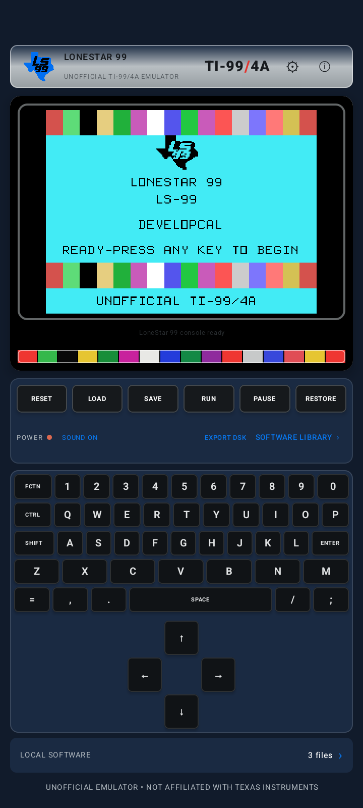

The source-built system-information page and both keyboard orientations were checked on the same phone.

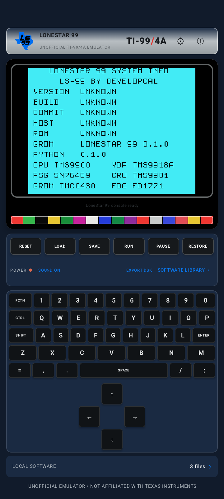

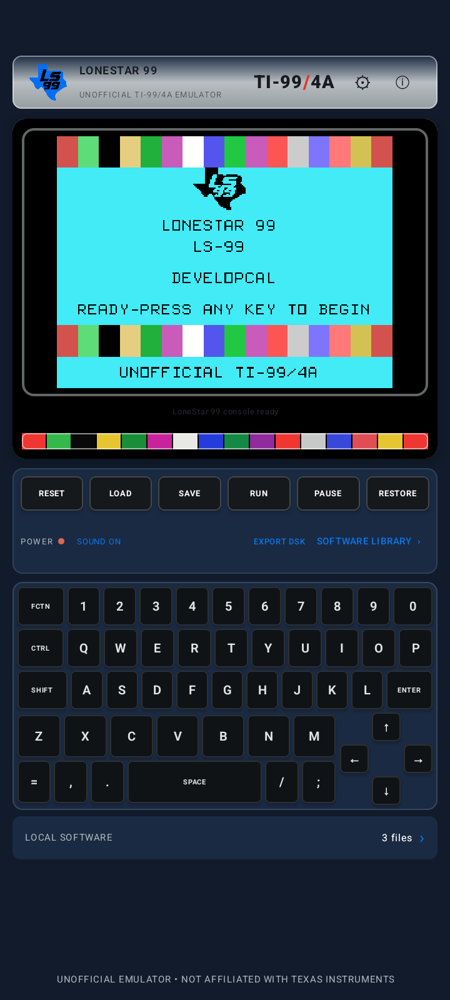

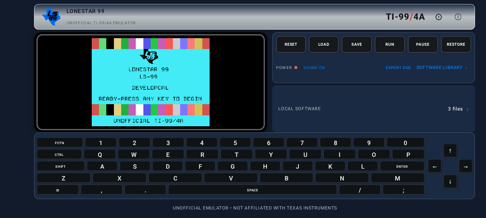

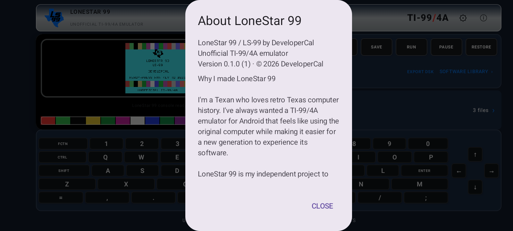

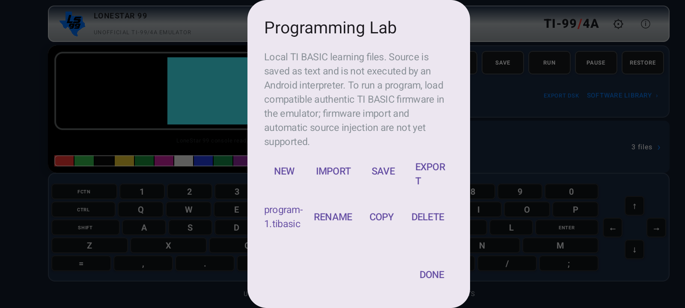

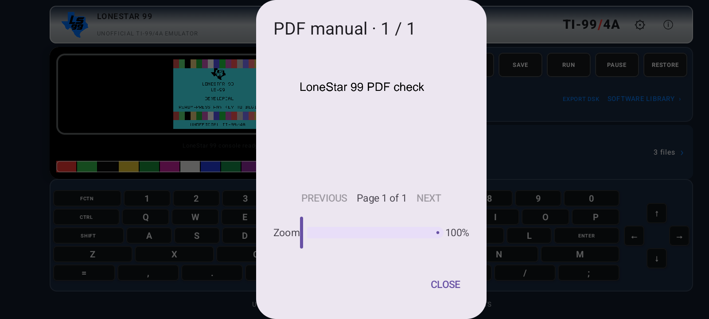


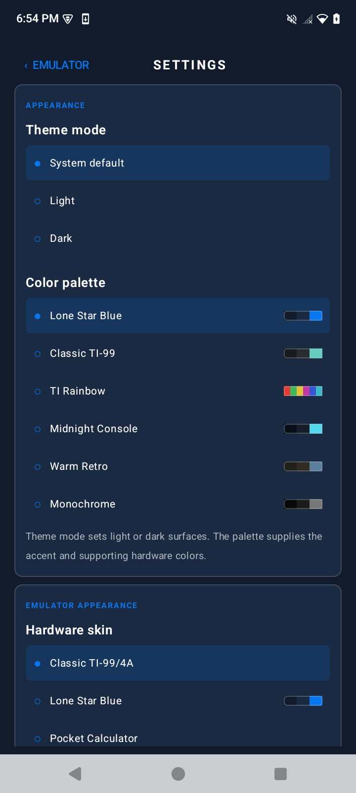


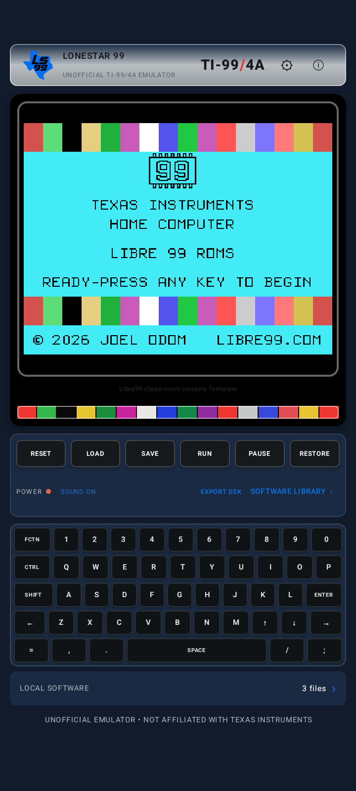

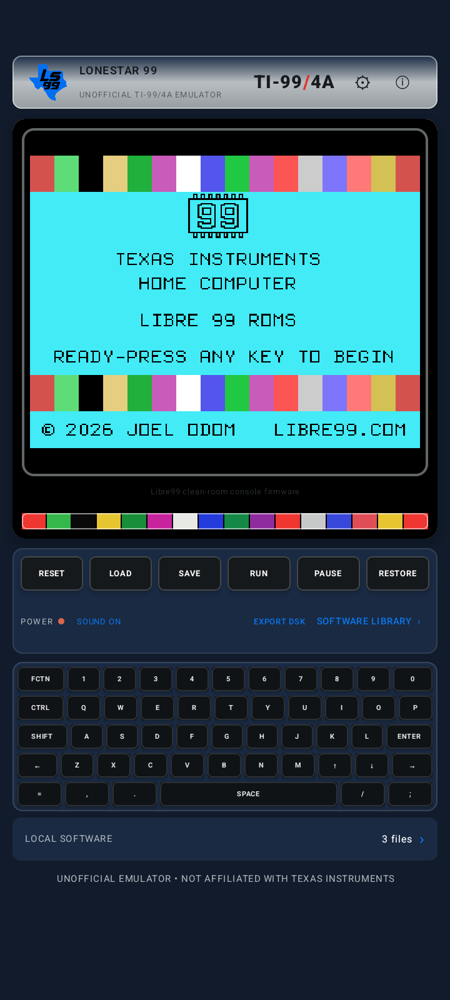

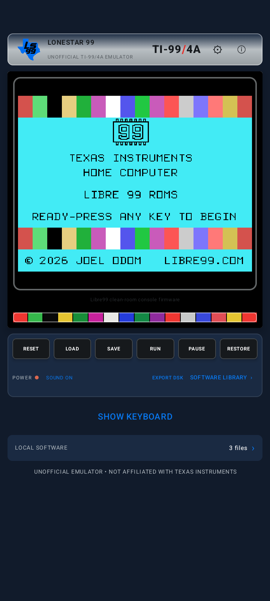

Theme modes were selected on-device and captured:


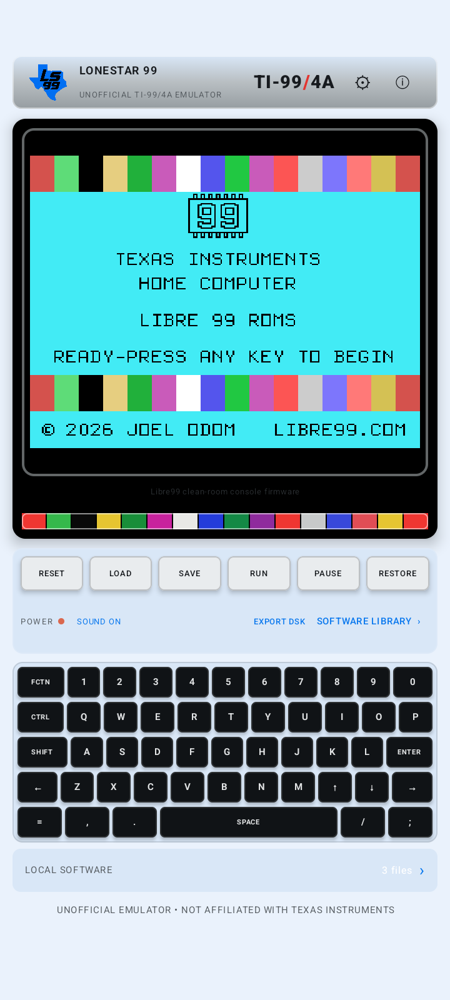


The six palette previews and active surfaces were also exercised on-device:


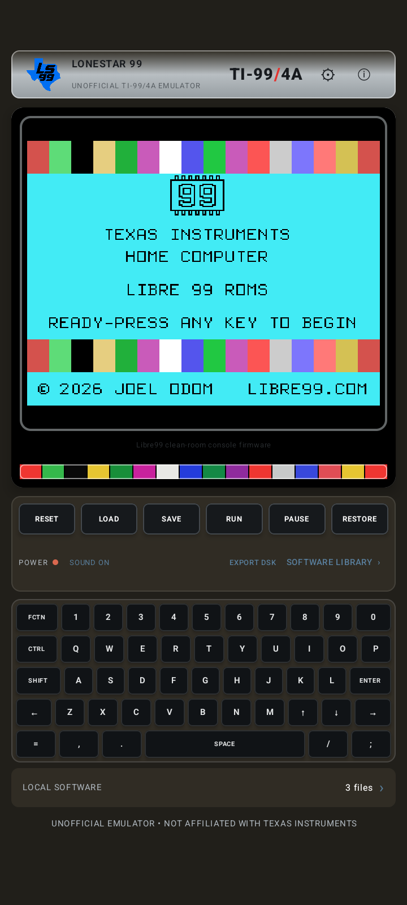

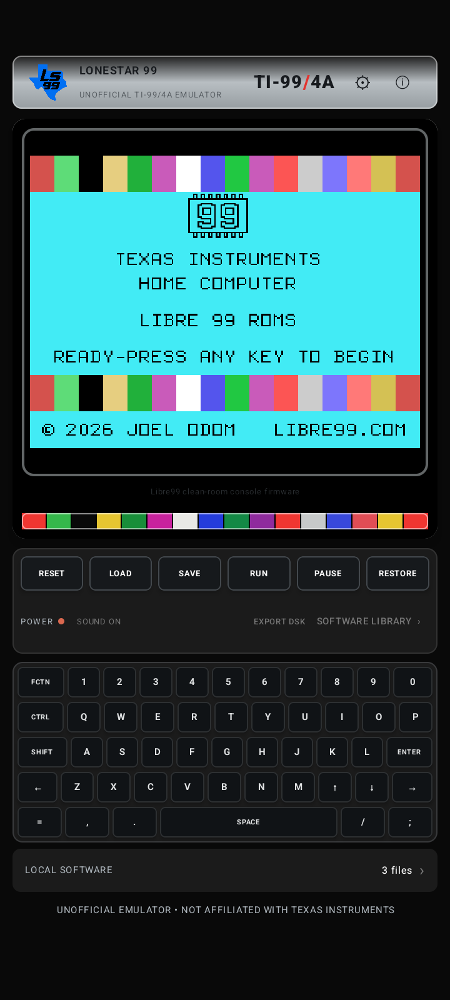

The bundled games were launched and advanced with the virtual keyboard inside the real emulator:

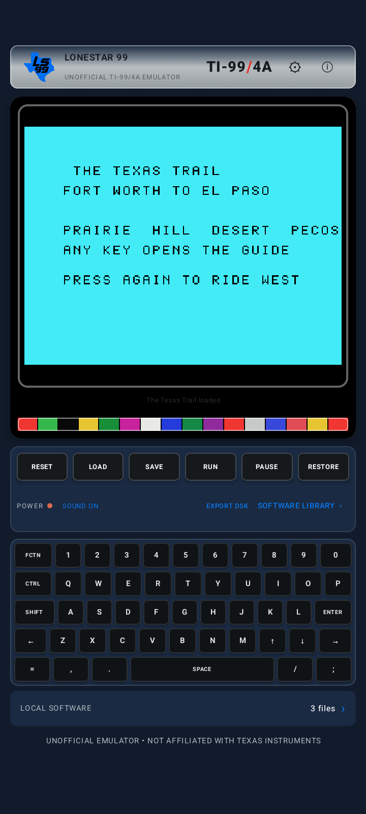

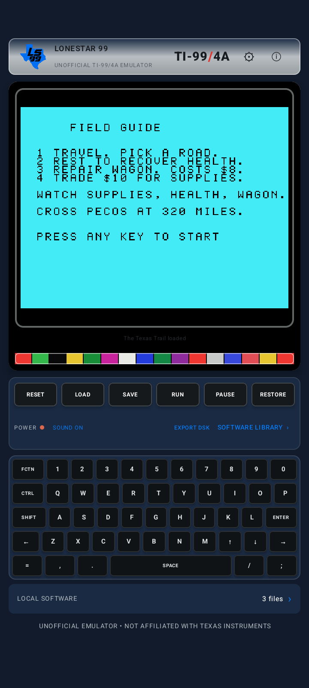

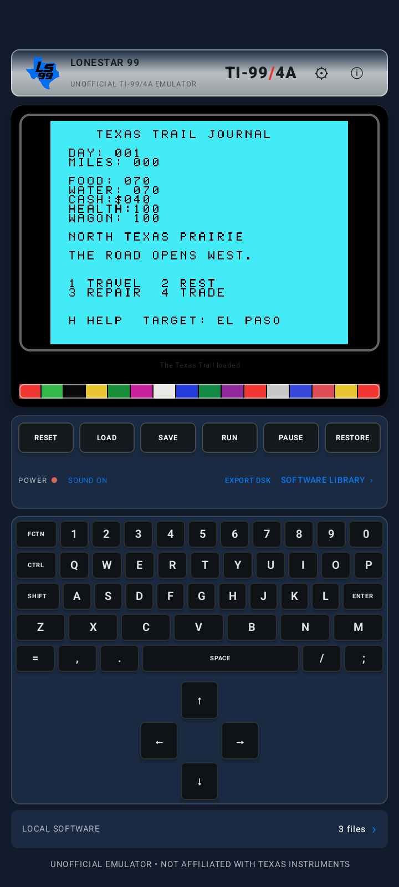

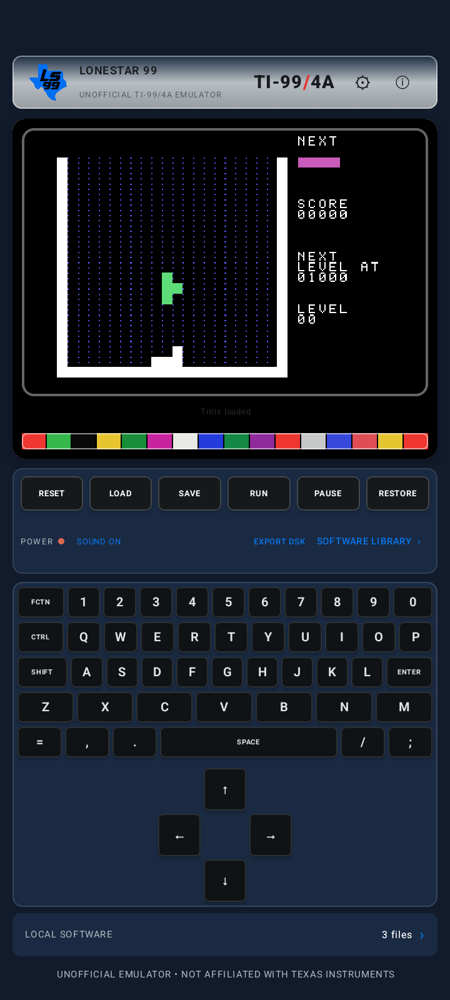

More captures, including route choices and the in-app licenses screen, are under [`docs/screenshots/`](docs/screenshots/).

## Licensing status: mixed components; app is not wholly GPL-3.0-only

The `LICENSE` file contains the complete GNU GPL version 3 text. It applies only to original DeveloperCal-authored components explicitly identified as `GPL-3.0-only` in their source headers and to the original Texas Trail game logic (excluding the separately licensed font table). See [LICENSE-SCOPE.md](LICENSE-SCOPE.md) for the file-by-file scope.

The integrated Android application also includes the Libre99 emulator core and clean-room firmware under a Modified MIT License with the Commons Clause. That clause restricts selling the software or products/services whose value derives substantially from it for a fee or other consideration. No GPL-compatible exception or separate permission was found in the vendored license or upstream project information. We do not change that component's license, and do not claim that the combined app is GPL-only or fully free-software compatible. Do not distribute the integrated app as a GPL-only application. See [THIRD_PARTY_NOTICES.md](THIRD_PARTY_NOTICES.md) and `app/src/main/rust/LIBRE99_LICENSE.md`.

The upstream Titris and Sokoban cartridges and the font table used by The Texas Trail retain their Libre99 terms; Sokoban also includes credited Microban levels. The Texas Trail cartridge therefore contains mixed-licensed material. The clean-room firmware sources and binaries, and the vendored Libre99 assembler, retain the Libre99 license. Android/Kotlin/Rust dependencies retain their own licenses. No authentic TI firmware or commercial software is bundled.

The project is not currently distributable as one genuinely free/open-source GPL-3.0-only Android application. A replacement emulator core with verified GPL-compatible terms or written permission from all relevant Libre99 rights holders would be needed to resolve that goal. See [CONTRIBUTING.md](CONTRIBUTING.md) before proposing licensing changes.

## Build

Requirements: JDK 17+, Android SDK platform 36, Android NDK 27.1.12297006, Gradle 8.10.2, Rust stable, and Rust target `aarch64-linux-android`.

```sh
rustup target add aarch64-linux-android
cd app/src/main/rust && cargo fetch --locked && cd ../../../..
gradle :app:assembleDebug
gradle :app:testDebugUnitTest :app:lintDebug
```

The APK is written to `app/build/outputs/apk/debug/app-debug.apk`. Rebuild and validate the source-generated startup GROM with `./tools/build-console-grom.sh`. The original cartridge is generated from TMS9900 assembly source with the vendored assembler:

```sh
cargo run --offline --manifest-path tools/texas-trail/Cargo.toml --bin build_cart
cargo test --offline --manifest-path tools/texas-trail/Cargo.toml --test gameplay
```

Android UI smoke tests are under `app/src/androidTest/`; they require a connected Android device and run with `gradle :app:connectedDebugAndroidTest`. `.github/workflows/android.yml` runs firmware/core/game tests, Android unit tests, lint, and debug/release assembly on pushes and pull requests.

Application ID: `com.developercal.ti99pocket`; version `0.1.0` (code 1); min SDK 26; target SDK 36; ARM64 only. Debug and signed release APKs build with a local release key configured outside this repository. Keep the keystore and its four `LS99_RELEASE_*` Gradle properties private and backed up separately; never commit them. Store an encrypted keystore backup in secure offline storage and keep the passwords in a password manager. The project does not publish or upload the key.

The signed **0.1.0 prerelease** APK is available on [GitHub Releases](https://github.com/TheDeveloperCal/LoneStar-99/releases/tag/v0.1.0). It is a prerelease, not a stable v1.0 release; see its notes for installation, checksum, licensing, and known limits.

## Privacy

The app requests no network permission and includes no analytics SDK or account service. Emulator state, imported software, PDF copies, and Lab files are stored locally by the app. Android's document picker grants access to files the user chooses. About/history/support links open through an external browser; that browser may use the network and its own privacy settings. Android backup behavior follows the device's system settings.

## Current limitations

- TI BASIC firmware import and TI BASIC program injection are not implemented. The Programming Lab instead runs source in the bundled clean-room TI PYTHON REPL, which is a separate, small Python-like language.
- PDF search is not provided by Android `PdfRenderer`; manual last-page position is saved per selected document. Manual redistribution rights were not established, so no manual is bundled.
- Game-controller/joystick input is not mapped from Android controllers. Physical keyboard support covers the implemented character, modifier, and directional keys.
- On the BLU B1660V, Texas Trail advanced from firmware selection through title, field guide, and gameplay; Titris advanced through its title screen, and directional input moved a piece during play. Portrait and landscape layouts and settings were inspected. No physical external Bluetooth/USB HID keyboard was connected for end-to-end hardware input verification; the supported key mapper is unit-tested.
- The integrated app is mixed-license and must not be distributed as GPL-only under the current Libre99 Commons Clause terms. See the ship-mode report for current signing, build, device, and publication status.
