# Emulator gameplay evidence

These images are rendered from the Libre99 `Machine` framebuffer after source-built CTGs booted through the real console firmware. Key input uses `TiKey` and the emulated keyboard matrix. This is host-side emulator evidence, not Android UI/device capture.

## STARLIGHT PATROL

**PASS** — firing scored, steering changed lane, and asteroid collisions reached game over.

Input: `firmware: Space, then 2 to start the mounted cartridge → 2: fire → 3: move right into the threat lane → 4: advance threat and collide`

- `title`
  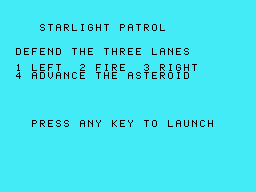
- `ready` — lane=1, threat=1, score=0, lives=3
  

- `shot-scored` — lane=1, threat=2, score=10, lives=3
  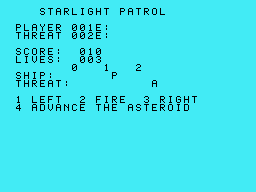

- `collision` — lane=2, threat=0, score=10, lives=2
  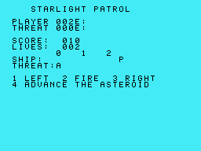

- `game-over` — lane=2, threat=0, score=10, lives=0, mode=2
  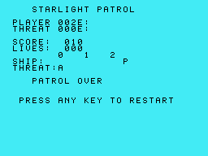

- `restarted` — lane=1, threat=1, score=0, lives=3, mode=0
  

## SOLAR SALVAGE 99

**PASS** — wall blocked movement, the cell was collected, and extraction reached the win state.

Input: `firmware: Space, then 2 to start the mounted cartridge → 2: move up → 3: attempt blocked passage → 4: move through maze → 3: move through maze → 3: move through maze → 4: move through maze → 3: move through maze → 3: move through maze`

- `title`
  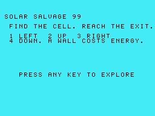
- `ready` — x=0, y=1, energy=8, cells=0
  

- `wall-blocked` — x=0, y=0, energy=6, cells=0
  

- `cell-collected` — x=4, y=2, energy=2, cells=1
  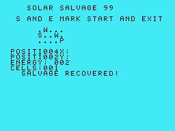

- `extraction-win` — x=4, y=2, energy=2, cells=1, mode=1
  

- `restarted` — x=0, y=1, energy=8, cells=0, mode=0
  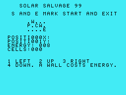

## OILFIELD OUTRUN

**PASS** — clear-lane driving scored distance; a hazard collision removed a life and repeated hits ended the run.

Input: `firmware: Space, then 2 to start the mounted cartridge → 2: accelerate through clear lane → 2: accelerate through clear lane → 2: meet the rotating hazard`

- `title`
  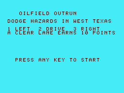
- `ready` — lane=1, hazard=2, distance=0, score=0, lives=3
  

- `distance-scored` — lane=1, hazard=1, distance=20, score=20, lives=3
  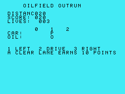

- `hazard-collision` — lane=1, hazard=2, distance=30, score=20, lives=2
  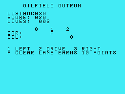

- `crash-game-over` — lane=1, hazard=2, distance=90, score=60, lives=0, mode=2
  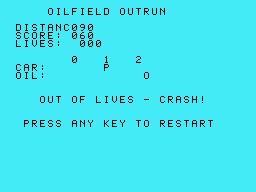

- `restarted` — lane=1, hazard=2, distance=0, score=0, lives=3, mode=0
  
